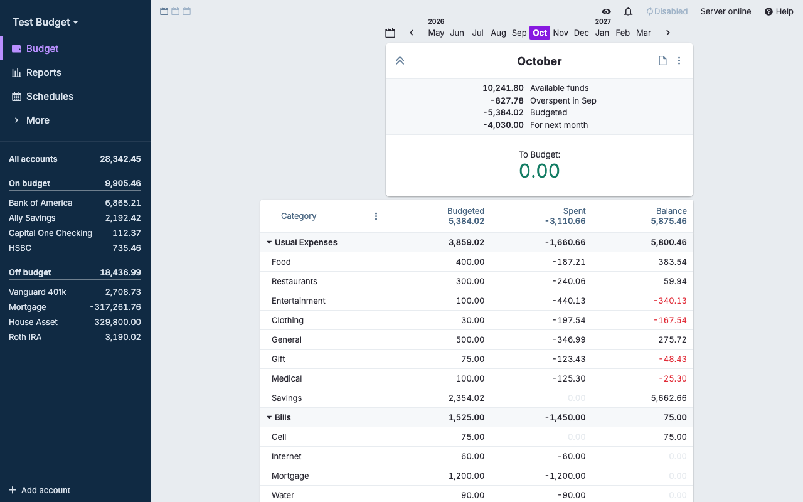
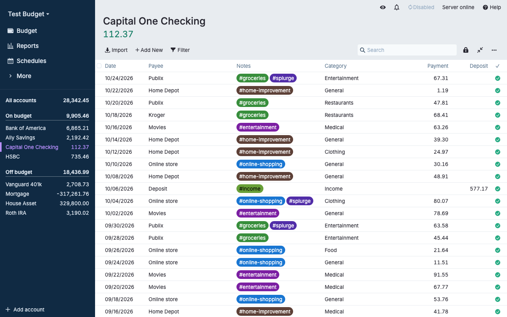
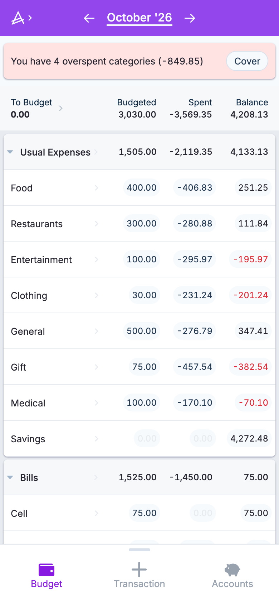

# Actual Budget on Cloudflare Workers

**Run your own Actual Budget sync server on Cloudflare Workers, Durable Objects and R2, with no server to maintain.** Use your [Actual Budget](https://actualbudget.org) budgets from any device.

[](https://deploy.workers.cloudflare.com/?url=https://github.com/Renji61/Actual-Cloudflare)

A Cloudflare Worker serves the official, unmodified Actual web app and handles the sync API. Your data lives in one SQLite-backed Durable Object and an R2 bucket in your own Cloudflare account.



<p>
  
  
</p>

> **Unofficial.** This project is not affiliated with or endorsed by the Actual Budget project. Screenshots show Actual's built-in demo data.

## Features and limits

- Single-password login, budget files, sync between devices, end-to-end encryption, export and import.
- Same paths, status codes and messages as Actual's own sync server, plus a password-reset endpoint (see below), so the stock Actual web app works against it unchanged.
- Installable on your phone as an app (PWA).
- **Not included:** bank sync, OpenID login, multiple users, user administration, header auth. The app hides or disables these.
- Passwords use PBKDF2-SHA256 (100,000 iterations), not argon2 like the regular server, because argon2 can't run on Workers. Hashes from another server can't be imported. Use a long, unique password.
- Everything runs in one Durable Object in one region. That suits one person or a family, not many users.

## Deploy

> **Whoever opens a fresh deployment first sets the password.** Set the `SETUP_PASSWORD` secret before the first visit (the steps below do), and consider [Cloudflare Access](#secure-it) as well.

### One click

1. Click the **Deploy to Cloudflare** button above. Cloudflare copies this repo into your GitHub account, creates the R2 bucket and Durable Object, and builds and deploys the Worker.
2. Enter a long, unique `SETUP_PASSWORD` when asked. This is the password you will log in with.
3. Open the `*.workers.dev` URL of the new Worker and sign in.

R2 must be enabled on your Cloudflare account first (see [Costs](#costs)). This flow depends on Cloudflare's Workers Builds and may change; if it fails, use the manual steps.

### Manual

You need [Node.js](https://nodejs.org) 22.13 or newer and a Cloudflare account. On a Mac, the double-click scripts in `scripts/mac/` run the same steps (output saved to `logs/`); `3-deploy` offers to set `SETUP_PASSWORD`.

```sh
git clone https://github.com/Renji61/Actual-Cloudflare.git
cd Actual-Cloudflare
npm install
npx wrangler login
npx wrangler r2 bucket create actual-budget-files   # name must match wrangler.jsonc
npx wrangler secret put SETUP_PASSWORD              # prompts for the password
npm run deploy
```

`npm run deploy` copies the web app into `public/` and uploads everything. Open the `https://actual-budget.<your-subdomain>.workers.dev` URL it prints and sign in with your `SETUP_PASSWORD`.

If you deploy first and set the secret afterwards, run `npx wrangler secret put SETUP_PASSWORD` and visit the site before anyone else does.

Actual needs HTTPS (except on `localhost`). `workers.dev` and Cloudflare custom domains are HTTPS already. You can rename the Worker (`actual-budget`) in `wrangler.jsonc` before the first deploy; it becomes part of the URL.

## Stay up to date

A copy made with the Deploy button does not follow this repo automatically. To get new releases, fetch them into your copy: use GitHub's **Sync fork** button, or run `git pull https://github.com/Renji61/Actual-Cloudflare main` in a clone and push. If you used the button, Workers Builds redeploys on every push. Otherwise run `npm install && npm run deploy`.

## Secure it

- **`SETUP_PASSWORD`** (optional secret). If no password exists when the Durable Object starts, the server sets it to this value, so the app shows its normal login screen and nobody can claim the "set password" screen. It is ignored once any password exists, so a password you change in the app is never overridden. An empty value is ignored.
- **Cloudflare Access** (optional). Put the Worker behind [Cloudflare Access](https://developers.cloudflare.com/cloudflare-one/policies/access/) for a second login in front of everything. Test it on your phone before relying on it.
- **Custom domain** (optional). In `wrangler.jsonc`, add a route such as `"routes": [{ "pattern": "budget.example.com", "custom_domain": true }]`, set `"workers_dev": false` if you want only that hostname, and deploy again.
- **Rate limiting.** Failed logins are limited to 5 per 15 minutes per client, like the original. The original's global limit of 500 requests per minute is not ported; add a Cloudflare WAF rate limiting rule for your hostname (**Security -> WAF -> Rate limiting rules**) if you want it.

## Use it on your phone

Open your URL in Chrome (Android) or Safari (iOS), sign in, and choose **Install app** or **Add to Home Screen**. It then opens like any other app.

## Move from a self-hosted Actual server

1. In the old Actual, open the budget and choose **Settings -> Export -> Export data** to download a `.zip`.
2. Open your new URL, sign in, and on the budget list choose **Import file -> Import a file exported from Actual** and pick the zip.
3. Open the imported budget and click **Register** in the "This file is not a cloud file" notice to upload it to the server.
4. On your other devices, point the app at the new URL (**Change server URL**), sign in and download the budget again. The budget gets a new sync ID on the new server, so other devices must download it again instead of reusing their old copy.
5. If end-to-end encryption was on, turn it on again: **Settings -> End-to-end encryption -> Enable encryption**.

Your old password can't be carried over (see limits above); you log in with the new one.

## Configuration

Variables in `wrangler.jsonc` under `vars`. Edit them and deploy again. Values must be quoted strings; an invalid value falls back to the default.

| Variable | Default | What it does |
| --- | --- | --- |
| `TOKEN_EXPIRATION` | `"never"` | How long a login stays valid. `"never"` keeps devices signed in until you log out or change the password (changing it signs out your other devices, not the one you change it on). A number is minutes, e.g. `"10080"` for 7 days. |
| `UPLOAD_LIMIT_MB` | `"50"` | Largest budget upload or sync request, in MB. Keep it at 50 or below (Worker memory and request-size limits). |

## Costs

Everything here runs inside one Durable Object, so what matters is how Cloudflare limits and bills it. Measured in production: sync requests use about 2 to 13 ms of CPU time, a login about 21 ms and first-time password setup about 55 ms (both hash your password), and the Worker in front uses 0 to 2 ms.

What Cloudflare's docs say (read in October 2026):

- **Durable Objects on the Free plan.** "Workers Free plan can only create and access SQLite-backed Durable Objects", which is what this project uses. Free includes 100,000 requests, 5 million rows read and 100,000 rows written per day, and 5 GB of storage; "If you exceed any one of the free tier limits, further operations of that type will fail with an error", and daily limits reset at 00:00 UTC ([Durable Objects pricing](https://developers.cloudflare.com/durable-objects/platform/pricing/)). Workers Free also has "a daily request limit of 100,000 requests" for the Worker itself ([Workers pricing](https://developers.cloudflare.com/workers/platform/pricing/)); requests for static files such as the web app are free and unlimited. Personal use is far below these caps.
- **CPU limit: unclear.** The Workers docs give the Free plan "10 ms" of CPU time per HTTP request ([Workers limits](https://developers.cloudflare.com/workers/platform/limits/)). The Durable Objects docs say both "Durable Objects are a special kind of Worker, so Workers Limits apply according to your Workers plan" and, in a table, "CPU per request: 30 seconds (default)" with no Free/Paid split ([Durable Objects limits](https://developers.cloudflare.com/durable-objects/platform/limits/)). The docs do not say plainly whether the Free plan's 10 ms applies to Durable Object requests, and this project has not been tested on the Free plan. If it does apply, logins and setup (about 21 and 55 ms) would fail on Free, and some heavier syncs could too.
- **Recommendation.** Use the Workers Paid plan (currently $5/month) for reliable logins. You can try Free first; if logins fail with "Worker exceeded resource limits" (error 1102), upgrade.
- **R2.** The free tier is 10 GB-month of storage, 1 million Class A and 10 million Class B operations per month, and free egress ([R2 pricing](https://developers.cloudflare.com/r2/pricing/)). That page does not say whether a payment method is needed, but in our experience R2 has to be enabled in the dashboard (**R2 Object Storage**) and Cloudflare asks for one, even for the free tier.

Limits and prices change, so check those pages before relying on this.

## Backups

Export each budget now and then (**Settings -> Export**) and keep the `.zip` somewhere safe. An export can be imported into any Actual server, including this one.

## FAQ and troubleshooting

**The deploy fails with an R2 error.** Enable R2 in the Cloudflare dashboard and create the bucket (`npx wrangler r2 bucket create actual-budget-files`).

**I can't log in on the Free plan.** See [Costs](#costs); the login may exceed the Free plan's CPU limit. Try again, or switch to the Workers Paid plan.

### Forgot your password, or someone else set it first

The regular Actual server has a `reset-password` script for this. There is no shell on Cloudflare, so this server has a recovery endpoint instead. It is switched off until you set a secret:

1. Choose a long random value (for example `openssl rand -hex 32`) and store it as a secret:

   ```sh
   npx wrangler secret put ADMIN_RESET_TOKEN
   ```

2. Call the endpoint with that value:

   ```sh
   curl -X POST https://<your-url>/account/reset-password -H "x-reset-token: <the value>"
   ```

3. Open the site. It asks for a password again, as on first visit. Set a new one.

This removes the password and signs out every device. Your budgets, sync history and end-to-end encryption keys are kept. Wrong tokens count towards the same limit as failed logins (5 per 15 minutes per client).

**If `SETUP_PASSWORD` is set**, a reset immediately restores that password instead of leaving the site open. So set or rotate the secret first (`npx wrangler secret put SETUP_PASSWORD`), then reset, then log in with it and change the password in the app. To switch recovery off again, run `npx wrangler secret delete ADMIN_RESET_TOKEN`.

For local development, put `SETUP_PASSWORD` in a `.dev.vars` file (copy `.dev.vars.example`; `.dev.vars` is not committed). To test recovery locally, add an `ADMIN_RESET_TOKEN=...` line to your own `.dev.vars`; the example file deliberately leaves it out.

## Local development

```sh
npm install
npm run dev     # wrangler dev at http://localhost:8787, local R2 and Durable Object storage in .wrangler/
npm test        # server tests on an in-memory database; needs Node 22.13+ (node:sqlite)
npm run typecheck
```

Nothing touches your Cloudflare account. `npm run dev` and `npm run build` first run `npm run prepare-web`, which copies the web app from the `@actual-app/web` package into `public/`.

## How it works

- **Worker** (`src/worker.ts`): API paths (`/account/*`, `/sync/*`, `/secret`, `/info` and so on) go to the Durable Object. Everything else is served as static assets, with unknown paths falling back to `index.html`. `/health` is answered without waking the Durable Object.
- **Durable Object** (`ActualStore`): holds the password hash, sessions, the budget-file list and sync messages in its built-in SQLite database. Actual's sync needs messages applied in strict order; each sync request's merge runs in one synchronous transaction, so sync stays strictly ordered.
- **R2** (bucket `actual-budget-files`): holds the budget files (encrypted by the app if you turn on encryption).
- **Static web app**: the official `@actual-app/web` build. `public/` is generated, not committed.

```
wrangler.jsonc          Worker, assets, Durable Object, R2 binding and settings
.dev.vars.example       Secrets used by the Worker (SETUP_PASSWORD)
scripts/prepare-web.mjs Copies the Actual web app into public/ and writes its headers
src/                    worker.ts, server.ts (the sync server), routes, http, storage, password hashing,
                        version.ts (generated by prepare-web)
src/vendor/crdt/        Copy of Actual's packages/crdt (sync message format), with its license
test/                   Tests on in-memory SQLite
```

## Updating to a new Actual release

The web app and the server should stay on matching Actual releases, because the app and the sync API change together. When you bump `@actual-app/web`, open a pull request: a workflow (`.github/workflows/upstream-check.yml`) comments on it with the upstream diff of the files listed below and labels it `safe-update` (nothing relevant changed) or `needs-port` (it did, or the tags couldn't be compared).

1. In `package.json`, change the exact version of `@actual-app/web` under `devDependencies` (no `^`).
2. Run `npm install`, then `npm run deploy`.

`npm run prepare-web` records the installed version in `src/version.ts`, which the server reports on `/info`.

Most releases need no server changes. To check by hand whether upstream changed the sync API, diff the files this project was ported from between the old and new release tags (tags look like `v26.10.0`):

```sh
git clone https://github.com/actualbudget/actual.git
cd actual
git diff vOLD vNEW -- \
  packages/sync-server/src/app-sync.ts \
  packages/sync-server/src/app-sync/validation.js \
  packages/sync-server/src/app-sync/services/files-service.ts \
  packages/sync-server/src/sync-simple.js \
  packages/sync-server/src/app-account.js \
  packages/sync-server/src/account-db.js \
  packages/sync-server/src/accounts/password.js \
  packages/sync-server/src/util/validate-user.ts \
  packages/crdt/src
```

No output means nothing relevant changed. If something did, port it into `src/server.ts` (or `src/password.ts`) and add or adjust a test in `test/server.test.ts`.

`src/vendor/crdt` is a copy of upstream's `packages/crdt/src` (`index.ts`, `crdt/index.ts`, `crdt/merkle.ts`, `crdt/timestamp.ts`, `proto/sync_pb.ts`). To refresh it, copy those five files from the new tag over the ones here, keep the folder layout and `LICENSE.txt`, then run `npm test` and `npm run typecheck`.

## Credits

Ported from [Actual Budget](https://github.com/actualbudget/actual).

## License

MIT, see [LICENSE](LICENSE). Based on Actual Budget (also MIT). `src/vendor/crdt` is copied from Actual's `packages/crdt` and keeps its `LICENSE.txt`.
